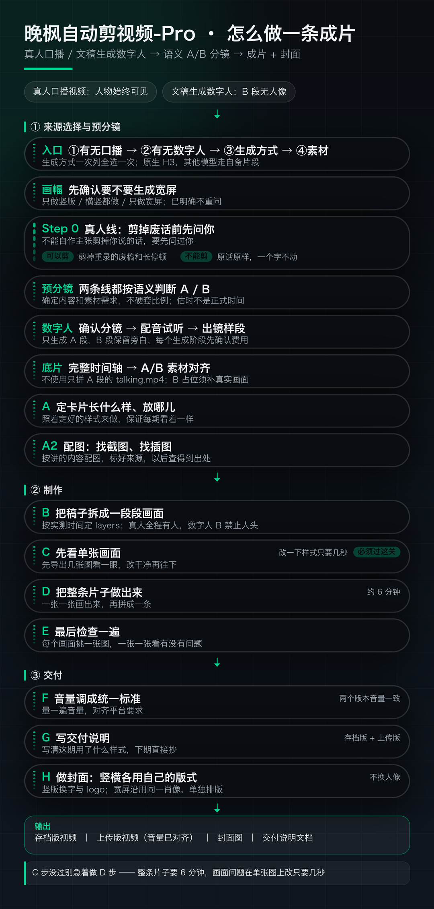

# 晚枫自动剪视频-Pro（mograph-pro）

> **v1.4.0：新增日常碎片vlog。随手拍的视频和照片放进目录，AI看素材、选形式、写旁白、设计丰富动画并剪成视频，不用先录口播或写稿。**
> 日常vlog独立选版式、字体、节奏与工具，不套圆形人头、固定卡片和封面模板。原真人口播与数字人A/B混剪、宽屏和封面功能保持原路径。
> 口播路径保留原Pillow包装；vlog以真实生活画面为主，支持本地逐帧动效、转场与声音混合。
> 本次更新内容与「还没验的部分」见 [CHANGELOG.md](CHANGELOG.md)。

---

## 一、30 秒看懂

**日常vlog新入口**：只给素材目录，说“帮我把这些随手拍剪成vlog，你选合适的形式，动画丰富一点，先出5秒”。不需要口播视频、稿子、字幕或数字人。AI先真实查看镜头再写旁白与时间轴；音乐和声音按授权准备。素材检视、基础动效和转场有可运行脚本；复杂创意不被脚本预设限制。详见 [独立vlog流程](references/daily-vlog.md)。

下表中的固定风格、圆头和封面是**原口播/数字人路径**，不强加给日常vlog。

免费版继续保留通用路径、晚枫专用路径和封面示例。下表重点比较**免费版通用路径**与 Pro 完整维护版；Pro 另提供完整打包交付、配套资产、持续更新与使用支持。

| | 免费版 `mograph` 通用路径 | **本 skill（Pro）** |
|---|---|---|
| 定位 | 给任何口播做**通用包装** | 晚枫账号的**专属成片线** |
| **说什么出什么（最核心）** | 贴静态字卡 | **任意文稿逐句配对应、且真的会动**的效果；参数从那句话里抽、不写死；换使用者、换稿子照样成立。你用大白话说「数字给我滚起来」也能直接改出来（`semantic-to-effect.md`） |
| **宽屏可选** | 固定一种 | 成片排版前一次选定：只做竖版 9:16（推荐）、横竖各一份、只做宽屏 16:9。宽屏按左右分栏重排，配独立横版封面（`aspect-ratio.md`） |
| 卡片怎么排 | 按内容自动判断卡片类型，自动放到上下左右 | **一段话配一个画面**，一个一个自己定 |
| 用什么工具做 | Remotion / HyperFrames / ffmpeg | **逐帧自己画**（本地包装用 CPU；数字人另选生成后端） |
| 整体样式 | 跟你的参考片走 | 固定一套样式（冷深蓝 `#0A0E13` + 品牌绿 `#00D693`） |
| 招牌排版 | — | **整屏排版**：背景 + 标题 + 主体卡 + **步骤条**；真人及数字人 A 保留圆形人头（**留手机安全边距，不贴上下边缘**），数字人 B 无人头 |
| 原始口播剪干净 | 有（先问过你） | 有，且**规则连具体数字一起给你**（71 号实证：184.14s → 114.32s，刀口 7/7 命中人工标注、零误删）；已剪成片 + 自带字幕则整步跳过、恒等映射 |
| 动画优先两阶段 | 无 | **有**（72 号实证）：先出纯动画 Demo 等你确认，再叠真人层；口播点名「动画」处逐帧真动，**全片任一画面不停超过 3 秒**，帧差数据验收 |
| 开头提速 | 无 | 真人保留底片与时间映射同步提速；数字人默认 1.0×，避免破坏口型 |
| 音量统一 | 无 | 有（自动量一遍，音量对齐到平台要求，出 **-14.4 LUFS** 的上传版） |
| 封面 | 无 | 有（**固定底图换字换 logo，人像完全不动**，自动检查三处；文案按视频号缩略图适配：更粗、更靠下） |
| 小绿书 / 小红书贴图 | 无 | 有（发布包整理时问一次，3:4 竖版 1080×1440，1 张主封面 + 3–4 张内页，深墨绿终端工作台风，`xiaolvshu.md`） |
| 交付说明 | 简版 | 八节交付说明（写清「本轮改了什么」「哪些勿改」） |

---

## 二、你买到的是什么



**双来源、统一成片流程**，保留原真人剪辑功能，数字人引擎已内置，无需安装其他 Skill：

```
入口  来源选择      → 真人口播视频 / 文稿生成数字人混剪
画幅 是否生成宽屏   → 未明确则一次选定：仅竖版 / 横竖双版 / 仅宽屏
0   确定可用文稿    → 真人先问删减；数字人无稿先协助写稿并确认
预分镜 语义 A/B     → 内容与素材需求（估时不能当最终时间）
数字人 素材准备    → plan → 配音试听 → 第一段出镜样段 → 补齐 → 完整时间轴
A   定版式与令牌    → mograph-task 工程骨架
A2  配图素材采集    → 截图 / 配图 / 红框标注 + 来源登记表
B   切场景表        → build_scenes()，逐句对齐 SRT
C   静帧复核        → 秒级出图，改版式只要几秒
D   重渲全片        → 逐帧渲染 + ffmpeg 管道
E   抽帧终检        → 每个场景抽一帧，逐张读图
F   响度归一        → 两遍法，出发布版
G   交接文档        → 八节接力文档
H   封面换皮        → 固定底图换字换 logo
I   小绿书贴图      → 发布包整理时问一次；要则出 3:4 竖版贴图套装（可选）
```

**外加三样可以直接抄走的东西**：

1. **设计令牌与版式库**（`references/wanfeng-path.md` §4–§5）：配色、字幕条、卡片圆角、胶囊配对铁律、
   `fs` 全屏分层坐标、圆形人头位置半径、步骤条、截图面板与红框规格 —— **每一行都是四轮用户反馈收敛出来的**，不是审美玄学。
2. **25 条硬规则**（W1–W25）：每条后面都写着「违反的后果」。其中 **W24「说什么出什么」是面向任意文稿 / 使用者的通用引擎**（映射表 + 效果基元库 + 指令通道 + 逐句对照表，见 `references/semantic-to-effect.md`）；**W25「宽屏选择」**（排版前一次选定；宽屏独立排版和验收，见 `references/aspect-ratio.md`）。22 条踩坑清单逐条附解法
   （基线锚点、胶囊同明度、语速只改一半、`✓` 字形缺失、投影盖字、椅子渗进墙面、宽光带盖正文、翻牌器重影、横版拉伸竖版帧……）。
3. **实证数据底账**：71 号原片的 30 块全表（含时长与 ASR 原文）、发布版保留的 25 句对照、
   删除量构成、阈值检验 —— 规则为什么这么定，写在数据里，不靠「经验」二字糊弄。

---

## 三、它跑起来是什么样子

**成片解剖**（81.3s / 1080×1920@30，真实发布）：

| # | 时间 | 版式 | 内容 |
|---|---|---|---|
| 1 | 0.2–8.4s | `fs` | 开场全屏设计：标签 + 三行标题 + 产品速览卡 + 步骤条，**人脸在左下**，字幕上移 |
| 2 | 8.5–10.9s | `overlay` | ¥0 大字卡 |
| 3 | 10.9–15.3s | `overlay` | 自曝卡「这条视频是它剪的」 |
| … | … | … | … |
| 15 | 75.8–81.3s | `overlay` | 片尾 CTA |

**节奏规律**：开场必 `fs` → 每 2–3 个 `overlay` 插一个 `fs` → 收尾回到 `overlay`。

**封面**：在固定底图上只换字、只换 logo，人像一像素不动；
三闸自检全是像素实测 —— 净空闸（字底到发顶 ≥ 30px）、明度闸（逐通道差 ≤ 6）、字号闸（拉丁号 = int(中文号×0.98/0.95)）。
模板脚本已与真实交付成品做过**逐像素比对，max diff = 0**。

**logo 不用你操心**：本地素材里有合适的就用；**没有合适的，它会自己从网上下载官方 logo**
（矢量优先、自动去白底裁留白、自动登记来源），并按「**在准确的前提下要好看**」的标准挑 ——
是不是这个产品、是不是官方源、是不是同一版本，三关全过才用，好看排在这三关之后。
拿不准就问你，宁可用纯文字提产品名，也不用近似 logo 硬凑。

---

## 四、环境要求

| 必需 | 说明 |
|---|---|
| Python | 用 `~/.workbuddy/binaries/python/envs/default/bin/python3`（Pillow 12.x + numpy + cv2 5.0） |
| ffmpeg / ffprobe | 必需 |
| 字体 | 视频使用 **Hiragino Sans GB**（macOS 自带）；封面使用 TencentSans W7 / Arial Bold，可用 `MOGRAPH_FONT_BOLD` / `MOGRAPH_FONT_LATIN` 指定路径；换字体须重验静帧 |
| 磁盘 | ~2 MB（本 skill 全部资产）+ 渲染中间产物 |

**真人剪辑不需要**：Node、npm、Chrome、GPU、付费 API、数字人依赖或密钥。

**仅数字人分支**：Python 3.10+、`requirements-digital.txt` 中的 requests，以及所选后端环境。支持 MiniMax / 软件积分 / 自托管 H3 画面 × MiniMax / 本地 Ming 语音；MiniMax 支持官方/推荐平台路由。模型、密钥、个人媒体不随包，不自动安装依赖。

生成前分别确认费用与素材上传；积分只覆盖画面，MiniMax 配音仍另计费。真实人脸、口型和云端效果待用户实跑验收。

---

## 五、怎么用

**装上以后在对话里说人话就行**：

日常vlog只给目录即可：

> 这些是我随手拍的视频和照片，帮我剪成一条vlog。没有稿子，你看素材选形式、写旁白，动画丰富一点，先给我看5秒。

想先审稿就说“先写旁白给我看”，不必自己写稿。可按任务明确使用本人已有克隆声音；没有声音配置不偷偷换音色，也不把付费配音说成免费。

原口播/数字人用法继续保留：

```
「这条口播视频按我们自己的风格剪，走晚枫那条路」
「用 mograph-pro 把这条做成有版式的成片」
「用这份文稿做数字人混剪，演示部分用纯 B-roll」
「做完顺便换张封面，把字改成「免费用 XX」」
「这条原片太啰嗦了，帮我剪一下」
```

**或者直接跑脚本**：

```bash
cd <skill 目录>

# ① 口播稿 + 字幕 → 场景骨架（零依赖、秒出）
python3 scripts/make_scene_plan.py --script 口播稿.md --srt 字幕.srt --stdout

# ② 原始口播 → 干净底片（需 ffmpeg，ASR 可选）
python3 scripts/cut_plan.py --video raw.MOV --out plan.json --report plan.md
python3 scripts/cut_plan.py --video raw.MOV --out plan.json --apply base.mov

# ③ 封面换皮（需托管解释器 + cv2）
cp templates/cover_from_base.example.py <选题>/AI剪辑输出/src/cover.py
# 改 CONFIG 里的【每期必改】项 → 跑 → 出图 → 三闸自检

# ④ 本地没有合适的 logo？自己从网上取（官方源，矢量优先）
python3 scripts/get_logo.py \
  --url "https://<官方直链>.svg" \
  --out "<选题>/AI剪辑输出/assets/logo/<brand>.png" \
  --brand "<产品名>" \
  --manifest "<选题>/mograph-task/assets/asset-manifest.json"
# 把输出的路径填进模板 CONFIG 的 LOGO_PATH 即可
```

---

## 日常vlog分支快速入口

```bash
# 素材只读；默认只检视目录直接子文件，不联网、不要求稿子
python3 scripts/vlog_scan.py --assets <素材目录> --out <选题>/剪辑过程/vlog/检视
# Agent真正看接触表后写镜头判断、旁白与JSON计划；脚本不猜故事
python3 scripts/vlog_render.py --plan <计划.json> --out <选题>/剪辑过程/vlog/样片.mp4 --validate-only
python3 scripts/vlog_render.py --plan <计划.json> --out <选题>/剪辑过程/vlog/样片.mp4 --preview-seconds 5
```

轻量渲染器支持打字、贴纸弹入、箭头/画框描线、动态进度、照片推近、方向转场与本地旁白/配乐混合；不是固定口播模板。5秒预览只渲覆盖该段的镜头。HDR素材需先明确转换SDR副本，不静默错色。新分支不要求固定肖像封面或自动生成小绿书。

本地脚本验收不代表所有创意已做完；每条真实成片仍需看关键帧、听声音、核验时长。完整契约见 [daily-vlog.md](references/daily-vlog.md)。

## 数字人分支快速入口

```bash
# 初始化到选题目录；Skill 安装目录保持只读
python3 scripts/init_digital_workspace.py --target <选题>/mograph-task/digital-human --video-backend credits
# 标记稿另存，每段以 [[A]] 或 [[BROLL:画面提示]] 开始
python3 scripts/digital_human.py --root <工作区> --script 标记稿.txt --job demo-v1 --stage plan
python3 scripts/digital_human.py --root <工作区> --script 标记稿.txt --job demo-v1 --stage digital --dry-run
```

以上均零生成调用。配音、试听、样段、补齐和回填必须按阶段授权，详见 [数字人混剪流程](references/digital-human.md) 与 [环境及排障](references/digital-setup.md)。

不要用跳过 B 时长的 `talking.mp4` 作底片：`assemble_digital_base.py` 按完整 `a_roll.json` 合成 A/B 与连续旁白。B 背景只是占位，正式 Pillow 渲染必须填好全屏素材或真实自绘 layers；缺素材禁止交付。数字人默认不额外提速，封面仍保留固定人像。

分发包将深目录引擎压为 `engine.tar.gz`，初始化时校验哈希、安全展开到工作区；只补缺失，不覆盖已有稿件、配置与结果。

## 六、七条可以单独跑的能力

不必做整条片，只要其中一件事：

| 单独跑 | 入口 | 依赖 |
|---|---|---|
| **说什么出什么（给任意文稿配效果）** | `references/semantic-to-effect.md` | 只需文稿 / SRT；逐句标锚点 → 查基元库 → 抽参数 → 出逐句对照表。不用懂代码，大白话提效果也行 |
| **画幅/比例设置（竖横版 / 各平台）** | `references/aspect-ratio.md` | 只需定档位；给出画布、安全区、横版重排版骨架，任何成片都先过这一关。默认竖版通发国内，不用选 |
| **语义删减** | `references/cut-feature.md` | 只需 ffmpeg（ASR 可选），不要 Pillow、不要 Node |
| **封面换皮** | `references/wanfeng-cover.md` | 托管解释器 + cv2，秒级出图；logo 本地没有就 `scripts/get_logo.py` 自己上网取 |
| **场景骨架** | `scripts/make_scene_plan.py` | 纯标准库，秒出，离线可跑 |
| **动画优先两阶段** | `references/animation-first.md` | 成片 + 现成 SRT 即可，无需重新识别；先纯动画 Demo 确认，再叠真人层出成片 |
| **小绿书 / 小红书贴图** | `references/xiaolvshu.md` | 发布包整理时问一次再决定；3:4 竖版 1080×1440，1 张主封面 + 3–4 张内页，模板 `templates/xiaolvshu.example.py` |

---

## 七、常见问题

| 现象 | 原因 | 怎么办 |
|---|---|---|
| `No module named 'PIL'` / `'cv2'` | 用错解释器 | 换 `~/.workbuddy/binaries/python/envs/default/bin/python3`，不是装包 |
| 文字叠在一起了 | `text()` 默认基线锚点，给的 y 是基线不是字顶 | 字顶 ≈ 基线 − 字号×0.86；或显式传 `anchor="lt"` |
| 全片渲完才发现版式不对 | 跳过了静帧 | 回 Step C，改版式只要几秒，别急着重渲 6 分钟 |
| 成片播出来是废的 | 渲染被会话回收打断，ffmpeg 没写 moov | 先 `ffprobe` 验时长（W9），报 moov 缺失就删掉重渲 |
| 改语速后音画错位 | 只改了音频没改画面时间轴 | 底片预处理 + `map_t()` 映射，两边都要改（W3） |
| 胶囊看得见框看不见字 | 前景色与底色同明度 | 见 §5.7 四种合法配对，改 pill 前先看 fg 和 bg 是不是同一亮度带 |
| 配图跟口播对不上 | 图上不是那句在讲的东西 | 查 `asset-manifest.json` 的 `shows` / `proves`，写不出 `proves` 的图换掉 |
| 找不到图 | 小众工具没公开截图 | 退自动效卡 / 自绘示意图，**绝不拿「看起来相关」的图硬凑** |
| 封面改完字压到头发 | 没跑三闸自检 | 净空闸 ≥ 30px，投影收在发顶之上 |
| 封面 logo 本地没有 / 不合适 | 本地素材里没有那个产品的标识 | 它会自己从官方源下载（`scripts/get_logo.py`）；拿不准准不准就问你，**宁可用纯文字也不用近似 logo** |
| 封面 logo 贴上去有一块白方块 | 白底 logo 没去透明 | 用 `scripts/get_logo.py` 取（自动去白底 + 裁留白）；确实要保留白底就加 `--keep-bg` |
| 换到别的机器就崩 | 字体 / 解释器不对 | 换 Hiragino Sans GB + 托管解释器，重跑静帧 |
| 想发 YouTube / B站横屏 | 正在确认交付画幅 | 说「只做横版」或「竖版再加一份宽屏」即可；横版独立重排，视频与横版封面进入 `发布包/横版视频/`（`aspect-ratio.md` §4.7） |
| 一个视频能不能通发国内所有平台 | 各平台比例看着不一样 | 能。默认通用竖版 9:16 就是最大公约数，安全区按各平台 UI 遮挡**并集**留白，一个文件发抖音/快手/视频号/小红书/B站竖屏都不被挡 |
| 想发公众号图文 / 小红书 | 只有视频和封面，没有图文贴图 | 发布包整理时我会问一次「要不要做一套小绿书贴图」，要则出 3:4 竖版套装（`xiaolvshu.md`）；不要就不做，不会擅自生成 |
| 这次更新了什么 | 版本变了但不知道多了啥 | 看 [CHANGELOG.md](CHANGELOG.md)，逐版本写了新增能力、修好的问题和还没验的部分 |

---

## 八、授权与许可

本 skill **已开源**，采用 **MIT-0**，见 [`LICENSE.md`](LICENSE.md)。

一句话：代码、文档、引擎与配套资产都可以自由使用、修改、商用与再分发，无需署名；
用它产出的视频归你所有。封面底图中晚枫本人形象仅限「固定底图换字换 logo」用途。

---

**说什么出什么（核心引擎）**：`references/semantic-to-effect.md` ·
**画幅/比例设置**：`references/aspect-ratio.md` ·
**主规范**：`references/wanfeng-path.md` ·
**动画优先支线**：`references/animation-first.md` ·
**封面打法**：`references/wanfeng-cover.md` ·
**配图规范**：`references/visual-assets.md` ·
**小绿书贴图**：`references/xiaolvshu.md` ·
**删减规则**：`references/cut-rules.md`
