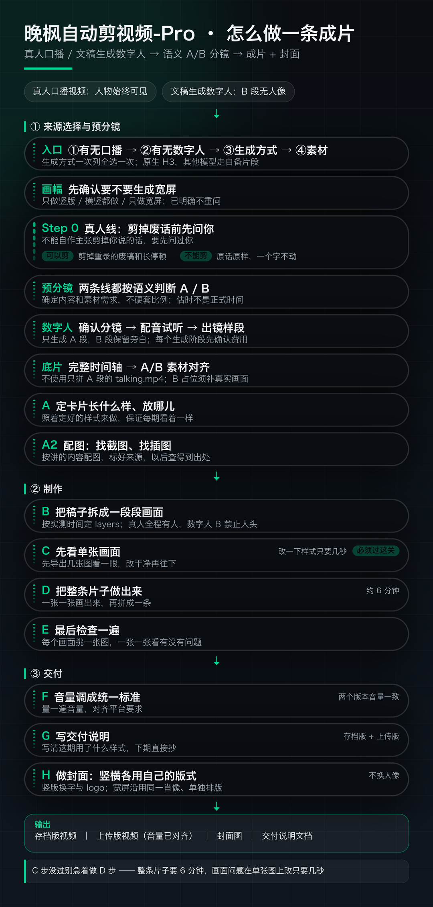

# 晚枫自动剪视频-Pro（mograph-pro）

> **本线只管两条路径**：已有真人口播 → 晚枫固定风格包装；文稿 → 数字人混剪。
> **日常随手拍的碎片视频 / 照片剪 vlog 不在这里**——那条线已经独立成姊妹技能 **晚枫自动剪vlog（`mograph-vlog`）**：
> 只给素材目录，AI 看素材、选形式、写第一人称旁白、排转场与动效，不要求口播或稿子。遇到这类需求直接改用那个技能，
> 不要在本线里追问「有没有口播稿」。

> **一句话**：真人口播视频 / 文稿生成数字人混剪 → 语义 A/B 分镜 → 逐帧包装 → 成片 + 固定底图封面。
> **最核心的一条能力：他说什么，就出现什么；出现什么，就真的会动。** 这不是某一期的效果，是给**任何使用者、任何一份文稿**通用的引擎 ——
> 逐句标出「能被看见的表达」，按 `references/semantic-to-effect.md` 的语义→效果基元库查出该配什么动效，**参数从那句话里抽，不写死**。
> 换个使用者、换份稿子照样成立。用大白话提「这个数字给我滚起来」「别停超过 3 秒」也能直接改出来。见 §3.8 与 W24。
> **完整成片先选要不要宽屏**：只做竖版、横竖各一版、只做宽屏三选一。已明确画幅不重复问；宽屏按横版专项制作（§3.9 / W25 / `aspect-ratio.md`）。
> 保留晚枫工作室真人成片打法；新增自包含数字人分支，不需要安装其他数字人 Skill。最终包装仍用 Pillow，不装 Node、不起浏览器。
> 真人设计规范来自历史交付；数字人时间契约做本地验证，真实人脸、口型与云端效果仍需用户实跑验收。

> **安装方式**：本 Pro 版已开源（MIT-0），可直接从仓库 `skills/mograph-pro/` 安装；也可在 WorkBuddy 开放平台技能页搜「晚枫自动剪视频-Pro」一键安装。
> **只是想先体验一下？** 可以先用免费版：https://skillhub.cn/skills/user_bf8c5b73/wanfeng-mograph
> 免费版继续保留通用路径、晚枫专用路径和封面示例；本 Pro 是完整维护版，额外提供完整打包交付、配套资产、持续更新与使用支持。免费版已公开内容的既有授权不受本次开源影响。

---

## 〇、这条线是什么

它不是「给口播加几张卡片」的通用工具，而是**晚枫工作室自己账号的成片打法**：

| | 本线（Pro） | 免费版 `mograph` 通用路径 |
|---|---|---|
| 卡片怎么排 | **一段话配一个画面**，一个一个自己定，排法由内容决定 | 按内容自动判断卡片类型，自动放到上下左右 |
| 用什么工具做 | **逐帧自己画**（本地包装用 CPU；数字人另选生成后端） | 用现成的成片工具（Remotion / HyperFrames / ffmpeg） |
| 要装什么 | 本地包装用 Python + Pillow + ffmpeg；数字人另查所选后端依赖，**不装 Node、不起浏览器** | 要装 Node 18+ 或浏览器 |
| 整体感觉 | 固定一套样式（冷深蓝 + 品牌绿），每期看着一样 | 通用，跟你的参考片走 |
| 封面 | 有（最后一步，固定底图换字换 logo） | 无 |

**四条不可替代的东西，Pro 线给全**：
① **说什么就出什么（最核心）**——任意文稿逐句配对应、且**真的会动**的画面效果，参数从那句话里抽、不写死；换使用者、换稿子照样成立。使用者用大白话提「数字给我滚起来」也能直接改出来（§3.8 / W24 / `semantic-to-effect.md`）；
② **整屏排版**（背景 + 标签 + 三行标题 + 主体卡 + 步骤条；真人及数字人 A 保留圆形人头，数字人 B 无人头）——晚枫号的固定排版；
③ **智能剪废话 + 按语速配画面 + 音量自动对齐**——把一口气录完的原片变成能直接发的成片；
④ **封面换字**——人像完全不动，只换字换 logo。

---

## 一、何时使用

**用它的时机**（用户这么说就触发）：

- 「这些是随手拍的零碎视频和照片，帮我剪成vlog」→ 改用姊妹技能 **晚枫自动剪vlog（`mograph-vlog`）**，不在本线追问口播或稿子。
- 「这条口播视频按我们自己的风格剪」「走晚枫那条路」「用 Pro 版剪」
- 「用文稿做数字人混剪」「演示部分用纯 B-roll，只在观点镜头出镜」
- 「帮我给这条口播做成有版式的成片」「加花字 / 加数据卡 / 加截图标注」
- 「做完顺便换张封面」「封面换皮」「把字改成 XX」
- 「这条原片太长太啰嗦，帮我剪一下」（只要 Step 0 也能单独跑）

**不要用它**（明确转介）：

| 需求 | 应该用 |
|---|---|
| 只要字幕，不要动效 | `embedded-captions` |
| 从零做一条无人出镜的科普片 | `knowledge-short-video` |
| 只要一个动效短片头 / 角标 | `motion-graphics` |
| 给任意口播做「通用包装」，不在乎品牌调性 | 免费版 `mograph` skill |
| 真人分支未经授权重新配音、复杂多轨 NLE 剪辑 | 不做；数字人分支按确认稿合成配音 |

---

## 二、前置条件（几个坑先说清楚）

1. **Python 解释器**：本线的渲染器要 **Pillow 12.x + numpy**，用托管解释器：
   `~/.workbuddy/binaries/python/envs/default/bin/python3`
   系统 `/usr/bin/python3` 只有 Pillow 11.3，报 `No module named 'PIL'` / `No module named 'cv2'` **就是用错了解释器，不是缺包**（封面脚本还需要 cv2）。
2. **字体**：只有 **Hiragino Sans GB**（macOS 自带，`/System/Library/Fonts/Hiragino Sans GB.ttc`，index 0=W3 / index 2=W6）。`✓` `✦` 缺字形（渲染成豆腐块，必须手绘）；`→` `①②③` 可用。
3. **ffmpeg / ffprobe**：必需。
4. **封面底图**：Step H 要用那张固定底图。**分发渠道不允许随包上传图片时，本机 `cover-assets/` 可能是空的** ——
   换皮脚本找不到会自动下载到 `~/.cache/wanfeng-mograph/cover/`，**AtomGit 国内源优先、GitHub 兜底**
   （国内打不开 GitHub 也能跑）：
   国内 `https://atomgit.com/CoderWanFeng1/wanfeng-skills/tree/main/skills/mograph/cover-assets`
   ／海外 `https://github.com/CoderWanFeng/wanfeng-skills/tree/main/skills/mograph/cover-assets`
   也可以手动下载，或设 `MOGRAPH_ASSET_DIR` 指向本机已有的 `cover-assets` 目录。详见 `references/wanfeng-cover.md` §0.1。
5. **封面 logo 的网络**：本地素材里有合适的 logo 就直接用；**没有的话 Step H 会自己从网上下载**
   （`scripts/get_logo.py`，只下载官方公开素材，不碰任何付费接口）。判据见 `references/wanfeng-cover.md` §1.2。

**不要试图起 Chrome / QuickLook**：沙箱锁死，GPU 起不来。**渲染必须后台直跑 python 命令**，不要 `&` + nohup 分离。

---

## 三、执行流（来源选择 + 预分镜 + Step A–H）



> 先按顺序分叉选来源与生成方式，再确认可用文稿与预分镜；正式 Step B 必须使用真实时间轴。出口仍是母版、发布版、封面、交接文档。
>
> **另有「动画优先」支线**：当用户给的是**已剪好的成片 + 现成 SRT**、或要求**先看动画效果再定**、或要求**全片画面不能停超过 3 秒**时，
> 不走上面这条一次出片的流程，改走 [`references/animation-first.md`](references/animation-first.md) 的**两阶段成片**：
> ① 纯动画 Demo（跳过 Step 0 删减、逐帧真动、全片节拍化、数据验证）→ **停下等用户确认** → ② 真人层 + 声音 + 封面 + 发布包。
> 阶段闸是硬约束：未确认前不许叠真人、不许出「成片」口径。

```
入口    · 来源与生成方式       → ① 有无口播 → ② 无口播则有无数字人 → ③ 有数字人则一次列全生成方式（选一次） → ④ 提供数字人素材（视频 / 图片）
画幅    · 是否生成宽屏         → 未选先问：只做竖版（推荐）/ 横竖各一版 / 只做宽屏；已明确则直接记录（§3.9 / W25）
Step 0  · 确定可用文稿        → 真人先问删减授权；AI 生成无稿先协助写稿并确认
预分镜  · 语义 A/B 判断       → 内容、出镜类型、素材需求（估时不是最终时间）
语义→效果 · 说什么出什么（贯穿主线 + 支线）→ 逐句标锚点 → 查 semantic-to-effect.md 基元库 → 参数从句子抽 → 逐帧真动（§3.8 / W24）
数字人  · 按阶段准备素材      → plan → 已有媒体校验 / 配音试听 → 第一段出镜样段 → 补齐 → 回填完整时间轴
Step A  · 定版式与设计令牌    → 抄 wanfeng-path.md §3 §4，建 mograph-task 工程；按选定画幅写 CANVAS（§3.9 / aspect-ratio.md §4），坐标参数化、横版用左右分栏骨架
Step A2 · 配图素材采集        → 按主题找图/截图/做标注，登记来源 → visual-assets.md
Step B  · 切场景表            → 按 wanfeng-path.md §5/§6 写 build_scenes()，逐句对齐 SRT；每句可视觉化表达都按 §3.8 配一个真动的效果
Step C  · 静帧复核（秒级）    → 出 PNG，用 Read 工具真读图，改到干净再往下
Step D  · 重渲全片            → 逐帧渲染 + ffmpeg 管道（约 6 分钟）
Step E  · 抽帧终检            → 每个场景抽一帧，contact sheet，逐张读图
Step F  · 响度归一            → 两遍法 loudnorm，出发布版
Step G  · 交接文档 + 交付     → 按 wanfeng-path.md §9 写文档，给两个文件
Step H  · 封面（换皮）        → 固定底图换字换 logo，人像不动 → wanfeng-cover.md
Step I  · 小绿书贴图（可选）  → 问用户要不要，要则按 xiaolvshu.md 生成公众号图片消息贴图
```

> **C 步之前不许进 D 步。** 全片渲染 6 分钟起，版式问题在静帧上改只要几秒。
>
> **A2 步为什么在 B 之前**：场景表里要写「截图面板」场景，得先有图可截、有标注可画。
> 先切场景表再回头找图，会出现「这场没图可用」的白工。

### 3.0 第一步 · 来源与生成方式（必须按顺序问，不要跳步）

先排除碎片 vlog：用户给的是随手拍的视频 / 照片目录、要剪成 vlog 时，改用姊妹技能「晚枫自动剪vlog」（`mograph-vlog`），不走本节。其余素材按下面三层分叉依次问，**上一层的答案决定下一层问什么**，不要一次性把所有选项抛给用户。

**① 有没有口播？**
- 有真人口播视频 → 走「真人线」（人物始终可见，先做 Step 0 删减授权）。**只有文稿不能当成已有真人视频。**
- 没有口播 → 走「AI 生成线」，进入下一问。

**② 有没有数字人？**（仅无口播时问）
- 没有数字人 → 画面和声音全部由 AI 生成，直接进 Step 0 写稿，不再追问生成方式。
- 有数字人 → 进入下一问。

**③ 用哪种方式生成数字人？**（仅无口播且有数字人时问）

**一次列全、选一次即可，不再分第二次问。** 先把所有可选方式摊开让用户挑，选定后画面+声音后端锁定，直接进第④问，不再追问「语音走不走 API」「用哪个模型」。

| 方式 | 画面 | 声音 | 要提供什么 | 费用 |
|---|---|---|---|---|
| **软件积分（credits）** | 自备片段 | 片段自带或另配 | 在软件里生成好带声音的口播片段，放进 `input/credits/`，引擎本地对齐 | 软件积分，零 RMB |
| **MiniMax 官方 API** | MiniMax H3 | MiniMax TTS（可克隆音色） | `MINIMAX_API_KEY`（按量付费密钥，非订阅通道） | H3 按秒 + TTS 按字符 |
| **MiniMax 推荐平台 API** | MiniMax H3 | MiniMax TTS | 推荐平台 `BASE_URL` + Key；须先说明供应方与上传位置 | 按平台账单 |
| **第三方 H3（自托管 / 租赁）** | ComfyUI H3 REF2VA 工作流 | H3 模型自带声音 | `COMPSHARE_BASE_URL`（如优云智算 Compshare 实例），本 Skill 不自动开机 | 实例小时费，API 费 0 |

**流行模型名对号入座**（名字都列在这，不用再点进第二层选）：

- **H3 / MiniMax H3** → 走「MiniMax 官方/推荐 API」或「第三方 H3」，看你想走 API 还是自托管。**引擎原生支持。**
- **Seedance（即梦 / 有时被叫 C Dance）、Kling（可灵）、Wan、Vidu、PixVerse、BDMAX 等** → 本 Skill 引擎**没有内置这些模型的原生 API 调用**。要用只能走第三方路线：在对应平台生成好带声音的口播片段 → 放进 `input/credits/` → 按「软件积分」路线本地对齐。选之前先说明平台与费用，不要假设 Skill 能直接调它们的 API。

> **铁律**：一次列全、选一次即可。选定后整条片子的画面+声音后端固定，不中途混着走。只有遇到上表未内置的模型、需要先确认平台与费用时，才补问一次；不得把未内置模型当成已支持直接生成。

**④ 提供哪种数字人素材？**（仅无口播且有数字人时问，需在③后确认）
- **带声音的视频** → 画面和声音都完整提供，校验媒体后直接复用，不重复生成；进入文稿/时间轴对齐和后续剪辑。
- **只有图片** → 画面由生成方式提供，单独选择声音来源（需获对应授权）：
  1. 另外提供声音文件 → 校验后复用；
  2. 让 AI 生成 → 使用③已选路线自身能力：第三方路线使用平台模型生成声音，API 路线使用所选大模型TTS；
  3. 本地自动生成 → 使用本地环境生成音频，不上传、不调用大模型API。

> **铁律**：选定生成方式后，仅 AI 需要生成的部分锁定后端，不强迫重生成用户已有媒体；用户提供媒体不视为切换/混和生成后端，第三方路线不得单独追问语音API。

**两线通用的预分镜与 A/B 规则**（选完来源与生成方式后才做）：
- 开场、观点、结论、收尾优先 A；操作演示、数据、案例证据优先 B。Agent 根据语义决定，不硬套比例、不按关键词直接定案。
- 真人完成已授权删减后按保留内容预分镜；AI 生成确认预分镜后才配音、按实测时间修正并生成 A 段。
- A/B 是内容侧重点，`overlay/fs` 是版式，不能混淆。真人 B 镜头仍保留圆形真人；数字人 B 镜头必须 `presenter=none`、无人头、全部台词仍有连续配音。
- 数字人线完整执行细节见 [digital-human.md](references/digital-human.md)，配置与故障见 [digital-setup.md](references/digital-setup.md)。

### 3.1 Step 0 · 语义删减授权（原始口播才走）

**不得默认开剪。** 先解释，再让用户选：

> 我可以先删除重录废稿、半截句和孤立口水词，并把过长停顿收紧到约 0.7 秒；默认保持内容顺序，不做重排。删减后我会给你一份完整保留口播稿，然后直接继续制作视频。是否允许？如果不允许，我会保持原片、原稿、内容顺序、停顿和时长不变，只做后续已授权的视频包装。

```bash
# ① 出计划 + 人可复核的报告
python3 scripts/cut_plan.py --video raw.MOV --out plan.json --report plan.md
# ② 读报告第四节「口播块全文」，逐条确认刀口
# ③ 认可就出底片
python3 scripts/cut_plan.py --video raw.MOV --out plan.json --apply base.mov
```

- 用户允许 → 出 `base.mov` + **交付 `clean-script.md`（完整保留口播稿，不是刀口清单）** → **不再等删减二次确认，直接按保留内容预分镜并进 Step A**。
- 用户不允许 → 跳过整个 Step 0，不跑 `cut_plan.py`、不执行 `--apply` / `--reorder`，原片原稿全部不动。
- 「允许删减」**不含重排授权**；`--reorder` 要另行取得明确同意，否则一律保序。

规则细节 → `references/cut-rules.md`；功能说明与核对清单 → `references/cut-feature.md`。

> **支线例外（animation-first）**：素材是**已删减成片 + 现成 SRT** 时，本步**整步跳过** ——
> 不跑 `cut_plan.py`、不重新识别字幕、原片 + 原 SRT 恒等映射。删减会整体偏移，字幕与画面全部错位。
> 见 [`references/animation-first.md`](references/animation-first.md) §2.1。

### 3.2 Step A · 定版式与设计令牌

数字人工作区放 `<选题>/mograph-task/digital-human/`，安装目录只读。仅数字人线检查 Python 3.10+、`requirements-digital.txt`、所选后端环境；真人线不加载数字人引擎、不检查密钥。初始化只补缺失，不能覆盖稿件、配置或产物。

抄 `references/wanfeng-path.md` §3（工程骨架与环境）、§4（配色 / 字幕 / 节奏）。
**先按 §3.9 确认是否生成宽屏**，按每个已选画幅在渲染器顶部写对应 `CANVAS`（`W/H/S` + 安全区比例 + `K`）：设计基准 1080×1920 的坐标数值勿改，只改落位换算；横版走左右分栏骨架，禁止拉伸竖版帧。
**设计令牌是用户确认过的，勿改**（W7）。工程目录：

```
<选题>/05-真人口播/
├── hy4-flash/                # 源素材（只读）
├── mograph-task/             # 工程目录（勿删）
│   ├── assets/               # 配图素材 + asset-manifest.json
│   └── src/
│       ├── render_full.py    # ⭐ 全片渲染器
│       ├── cardlib.py        # 绘图基元
│       ├── design.py         # 背景 / tighten() / 字幕层
│       ├── anim.py           # 缓动函数
│       └── qc_full.py        # 成片自动抽帧自检
└── AI剪辑输出/               # 交付目录
```

### 3.3 Step A2 · 配图素材采集

**先问用户一次**（不要拆成三轮追问）：

> 配图这块我确认三件事：① 有现成截图可以直接用吗？② 有没有链接或官网地址，我可以自己去截？③ 都没有的话，我按「<主题>」去网上找，找不到就用动效顶上，可以吗？

规范见 `references/visual-assets.md`。三条硬判据（图上出现的东西必须正是那句口播在讲的 / 图上不可见的内容不能当证据 / 文件名与 OCR 命中都不等于证据成立）落到 W13–W15。

### 3.4 Step B · 切场景表

**手写，不靠正则。** 先用骨架脚本定位时间区间：

```bash
python3 scripts/make_scene_plan.py --script 口播稿.md --srt 字幕.srt --stdout
```

真人旧调用仍输出 `@1`，用 `digital_contract.normalize_plan()` 兼容读取为 `@2`，Agent 补充语义 `roll=a|b`，`presenter=full|circle` 始终有人。数字人用 `--source-mode digital-human --digital-timeline <完整a_roll.json>`，按段保留真实边界、编号和媒体路径，不再按 5–12 秒重分组。

数字人正式渲染采用 [digital_render.example.py](templates/digital_render.example.py) 的分支与终检闸：A 保留人物，B 全屏素材/自绘 layers 且不绘人头；未实现 B layers 或缺素材禁止全片交付。数字人不留 0.1–0.2 秒场景空档，默认不额外提速。

骨架只给「时间区间 + 建议版式 + 该段口播原文」。**正式渲染前必须按 `wanfeng-path.md` §5 / §6 手写每一场的 layers 与文案** —— 这一步交给审美，不交给正则。
**同时按 §3.8 / `semantic-to-effect.md` 给每句可视觉化表达配一个真动的效果基元**（W24）：语义判断交给 Agent，效果从基元库查、参数从那句话抽，不靠关键词正则、不写死数值。

### 3.5 Step C · 静帧复核（秒级）

```bash
cd ".../mograph-task"
~/.workbuddy/binaries/python/envs/default/bin/python3 -u src/render_full.py stills 2,8.5,15.5,32.5
```

输出到 `/tmp/qc/`。**必须用 Read 工具真的把图读出来看**，不能只看脚本打印。

**用户想要一段能播的短样片时**，按「只渲这一小段、不渲全片」的原则做（默认 5–10 秒，用户可指定时长），确认后再进 D 步。

### 3.6 Step D → E → F → G

见 `references/wanfeng-path.md` §8（渲染与交付）。**D 步渲完先 `ffprobe` 验时长再谈内容**（W9）——
后台任务会被会话回收打断，ffmpeg 边写边封装，进程被杀会产出「moov 缺失」的废片。
E 步**逐张读图**（W5），F 步两遍法 loudnorm 出 `-14.4 LUFS / TP -1.0` 的发布版，母版留档（W6）。

### 3.7 Step H · 封面换皮

见 `references/wanfeng-cover.md`。六步：复制模板 → **取 logo** → 改 CONFIG → 跑脚本 → 三闸自检 → 读图交付。
**竖版在固定底图上换字换 logo，人像不动**（W12）。横版按 §3.9 独立排版，直接沿用同一选题竖版成品中的肖像与表情，不拿其他帧代替。
**文案粗细与位置按视频号缩略图适配**（W12 / `wanfeng-cover.md` §2.1）：第一行下移 + 描边加粗一档，
出图后与频道内高表现封面并排对比；第二行受头发净空硬限制不下移。

**logo 从哪来**：本地有合适的就用；**本地没有合适的，可以自己从网上下载**（W18）。
取件与规整用 `scripts/get_logo.py`（下载 → SVG 转 PNG → 去白底 → 裁留白 → 登记来源）：

```bash
~/.workbuddy/binaries/python/envs/default/bin/python3 \
  skills/mograph-pro/scripts/get_logo.py \
  --url "https://<官方直链>.svg" \
  --out "<选题>/AI剪辑输出/assets/logo/<brand>.png" \
  --brand "GLM" \
  --manifest "<选题>/mograph-task/assets/asset-manifest.json"
```

**判断标准是「在准确的前提下要好看」——顺序不能倒**：

- **准确性优先**：① 是不是这个产品 ② 是不是官方源（官网/官方 GitHub/官方社媒，优先 SVG）③ 是不是同一版本。
  三关任何一关不过就不许用，好看排在这三关后面。
- **好看**：矢量优先、源图最短边 ≥ 256px、透明底、无四周留白、优先官方横排整条（别自己拼图标+字标）。
- **来源必须登记**（W15）：`--manifest` 记 url 与抓取日期，不许跳过。
- **拿不准就问用户**；官方源都取不到就宁可用纯文字，也不用近似 logo。

模板侧：把取到的 PNG 填进 CONFIG 的 `LOGO_PATH`，其余照旧。留空则走原来的手绘图标路径
（58 号已验证，逐像素 max diff = 0，**本次改动零回归**）。模板按宽高比自动落位：
方形图标 → 贴图标位、字标仍用 `WORD_TEXT`；横排整条（宽/高 ≥ 1.6）→ 整条进 `LOGO_BAND`，停用 `WORD_TEXT`。

### 3.8 说什么出什么（主线通用引擎，最核心的一条）

**每个使用者、每份文稿都走这一步**，不是 72 号专享。完整方法、通用映射表与效果基元库见
[`references/semantic-to-effect.md`](references/semantic-to-effect.md)，这里只写必须遵守的契约：

> **他说什么，就出现什么；出现什么，就真的会动。**
> 「他说」= ① 口播文稿 / SRT 里写的话，② 使用者在对话里用大白话提的效果或修改。两者走同一套引擎。

| 步 | 做什么 | 硬要求 |
|---|---|---|
| S1 标锚点 | 逐句 / 逐条 SRT 圈出「可视觉化表达」（数字、增减、对比、流程、清单、聚焦、强调、命名、时间、收尾…） | 纯观点句也要标，走短句卡点 |
| S2 归意图 | 每个锚点归到一种语义意图 | 语义判断由 Agent 做，**不靠关键词正则硬套** |
| S3 查基元 + 抽参 | 查 `semantic-to-effect.md` §4 效果基元库，取逐帧算法；数字/倍数/名词/条目数**从该句里抽** | **参数不许写死成上一期的值**；文稿没点名的不许编造 |
| S4 对齐轴 | 按 SRT 起止 / 语速把效果钉到时间轴 | 一句一效果或一句一拍，≤3s 切（W20） |
| S5 验收 | 逐句「文稿原话 → 意图 → 基元 → 参数 → 是否真动」对照表 + 有过程 + 节奏数据 | 对照表随 Demo 一起交付；全片搜一次残留硬编码值 |

- **面向使用者**：他不用懂 Pillow、不用写代码、不用知道参数名；给稿子，或说一句「这个数字给我滚起来」「别停超过 3 秒」，Agent 按 `semantic-to-effect.md` §5 的指令对照表解析成「锚点 / 基元 / 参数」，只改那一处、局部出静帧复核，不重做全片。
- **72 号 `6000→50000`、`×8.3`、柱状图、放大镜都是那一份文稿抽出来的参数，是示范不是默认值** —— 换稿自动换成新稿里的值。
- 与 `animation-first.md` 的关系：那条支线里 §2.3 的「口播点名 → 逐帧过程」表是 **72 号实例**；通用映射以 `semantic-to-effect.md` §3 §4 为准。两阶段 Demo 的 S1–S5 同样调用本引擎。

### 3.9 成片前确认是否生成宽屏

**完整成片和正式样片必经此环节；宽屏本身可选。** 确认素材来源后、排版或数字人生成前（动画优先支线在 Demo 前），尚未明确画幅时主动问一次。优先使用单选框；不支持单选框时直接用文字列出这三项：

> 这条要不要出 **16:9 宽屏版**？① 只做竖版 9:16（推荐）；② 竖版 + 宽屏各一份（如 B 站横屏）；③ 只做宽屏 16:9。已有指定平台或比例也可以直接告诉我。

等用户选择后锁定画幅；未回复不当作授权生成宽屏。已经明确画幅则直接记录，不重复问；「另做宽屏」保留已有竖版，只加横版；仅改现有视频或封面的一处，继承原画幅。完整决策表见 [`references/aspect-ratio.md`](references/aspect-ratio.md) §1。

- **通发口径**：9:16 是国内主流短视频的最大公约数；一个通发版按各平台 UI 遮挡的**并集**（顶 12% / 底 20% / 右 15% / 左 8%）留安全区，一个文件发到哪都不被挡。横竖是两种构图，一个文件不能既竖又横。
- **必须参数化（W25）**：`wanfeng-path.md` 的坐标全是竖版 1080×1920 绝对像素 —— 这些是**设计基准，勿改数值**（W7），但要经 `CANVAS`（`W/H/S` + 安全区比例 + `K=min(SX,SY)`）换算后再画。竖版族按 `SY` 纵向重分布，3:4 / 1:1 不许直接压坐标。
- **横版必须重排版**：**禁止**把竖版帧等比拉伸 / 加黑边 / 直接裁切。16:9 走左右分栏骨架（左标题 + 圆头、右主体卡，字幕条居中靠下），字号按 H 重定，圆头仍实时裁 + 画网格实测。
- **选择宽屏后执行专项**（[`aspect-ratio.md`](references/aspect-ratio.md) §4.7）：完整操作原图 + 红框/箭头，必要时加局部放大；晚枫账号左上固定「程序员晚枫」、章号保留；用语义辅助色丰富动效，不改截图颜色与肤色；同选题的独立横版封面使用已确认竖版成品的同一肖像和表情。横版视频和封面放 `<选题根>/发布包/横版视频/`，过程文件另放。
- **联动及验收**：数字人 `--aspect` / `RATIO_SIZES` 与各自 `CANVAS.preset` 一致。Step C 画安全区框读图；`ffprobe` 验目标分辨率、帧率、时长；横竖分别检查截图标注、动态圆头、字幕、节奏和音画。

---

## 四、硬规则（W1–W25，不许违反）

| # | 规则 | 违反的后果 |
|---|---|---|
| **W1** | 静态帧不干净不重渲全片 | 6 分钟白跑 |
| **W2** | `text()` 的 y 一律按**基线**算 | 版式重叠 |
| **W3** | 改语速须同步音频、视频、字幕与场景；真人保留 `map_t()`，数字人默认 1.0× | 音画错位 |
| **W4** | 真人及数字人 A-roll 的 `fs` 保留步骤条与圆形人头；数字人 B-roll 保留设计语言与步骤条但禁止人头 | 人物规则串线，破坏混剪契约 |
| **W5** | 终检必须**逐张读图**，不能只看抽帧数量 | 漏掉的问题直接发布出去 |
| **W6** | 交付必须同时给母版与响度归一版，并写清哪个是发布版 | 用户发错版本 |
| **W7** | 用户已确认的设计令牌（配色 / 字体 / 节奏）**不许擅改** | 账号调性漂移 |
| **W8** | 交接文档必须写「本轮改了什么」+「哪些勿改」 | 下一次接力重做一遍 |
| **W9** | 渲染完**先 `ffprobe` 验时长**，再谈内容 | 拿着 moov 缺失的废片当成品交付 |
| **W10** | pill 的 fg 与 bg 必须跨明度配对 | 出现「看得见框、看不见字」的空胶囊 |
| **W11** | 保留冷深蓝底与品牌绿，不主动提整套暖色换皮。横版可按 §3.9 用金、玫瑰等辅助色强调语义，不改底色、截图、肤色 | 账号调性漂移，用户返工 |
| **W12** | 竖版沿用固定底图，文案适配视频号缩略图；横版独立排版，直接取同一期已确认竖版封面的同一肖像与表情。没有竖版时用用户确认的固定肖像；禁止抽新视频截图、用补发丝参考帧替代或拉伸人像 | 同一选题人像表情不一致，封面构图失控 |
| **W13** | 配图必须与它所配的那句口播**严格对应** | 画面与口播对不上，观众当场看出来 |
| **W14** | 操作类与知识分享类的配图**必须做标注** | 观众不知道该看哪儿，图等于没配 |
| **W15** | 外部图片必须记来源与截取日期，进 `asset-manifest.json` | 素材不可追溯，商用有版权风险 |
| **W16** | 原始口播未经用户明确授权不得删减；允许后交付完整保留口播稿并直接继续成片 | 擅自改内容，或把流程停在删减阶段 |
| **W17** | 时间戳是估算（4 字/秒）时必须显式标注，渲染前必须让用户试听对齐 | 卡点错位，整片返工 |
| **W18** | 封面 logo **准确性优先于好看**：① 是这个产品 ② 官方源 ③ 同一版本，三关全过才许用；外部 logo 必须登记来源（W15）；宁可用纯文字也不用近似 logo | 挂错 logo = 事实错误，比不好看严重得多 |
| **W19** | 口播里说「动画」的地方必须是**有过程的逐帧运动**（数字一帧帧滚、柱子从 0 长、逐字打出、框逐段描、放大镜真 scale），禁止整块淡入冒充 | 宣传片里说会动却不动，效果打折、用户返工 |
| **W20** | 全片**任一单一画面停留 ≤3s**（看清就切、快慢有区分），且必须用帧差/单拍时长/连续静止段三项**数据验证**，不靠目测 | 一句话贴 6–11 秒不动，节奏拖沓整片重做 |
| **W21** | 动画优先支线走**两阶段**：纯动画 Demo 未获用户明确确认前，不叠真人层、不做封面/响度、不出口径为「成片」的交付 | 越过阶段闸，白做合成与封面 |
| **W22** | 真人圆头**从当前原片帧实时裁**（人在动、口型在动，非静态贴片）、开场即展示；新素材必须**画网格实测多帧包络**，源圆同时容纳头顶、下巴和左右脸并留非零运动余量，**下巴不是圆底、头顶不是圆顶**；开场 / 中段 / 结尾与动作最大帧必须抽圆头静帧逐张读图；氛围层画在内容之前，**任何元素不得遮挡圆头**；圆头位置必须留**手机安全边距**（顶边距画面顶 ≥180px、底边距画面底 ≥320px，往垂直中带收） | 只裁到额头或下巴 / 头顶被标注条切掉 / 宽光带盖住正文 / 贴边圆头在手机上被视频号 UI 遮住或看着奇怪 |
| **W23** | 参考外部动画项目前必须核实许可证（免费商用 + 可二开 + 可闭源），**结论落盘**；只借风格与运动语言，不搬源码/素材/字体/音频 | 版权风险；把第三方依赖条款带进自有代码 |
| **W24** | **说什么出什么是主线通用能力**：任意文稿逐句标可视觉化锚点、每个锚点配一个**参数从该句抽取且有逐帧过程**的效果基元（查 `semantic-to-effect.md` §3 §4），并**落盘逐句对照表**验收覆盖；参数不许写死成上一期的值、文稿没说的不许编造；使用者用大白话提效果也按 §5 指令通道解析成「锚点/基元/参数」 | 换个使用者 / 换份稿子就退化成「随便贴几张静态卡」，宣传的「说什么出什么」当场穿帮；或把 72 号的 `6000→50000` 抄进别人的片子里 |
| **W25** | 完整成片或样片在排版前确认一次「仅竖版 / 横竖双版 / 仅宽屏」；已明确不重问、不擅自多导出。分别用 `CANVAS` 和百分比安全区，横版走左右分栏、禁止拉伸 / 加黑边 / 直接裁切竖版；同时遵守 [`aspect-ratio.md`](references/aspect-ratio.md) §4.7 的原图标注、署名、配色、封面与归档规则 | 画幅未确认、人物变形或操作位置不明；混淆发布版本 |

> 完整版（含违反后果的细节）见 `references/wanfeng-path.md` §11。
> W19–W23 的实证与可执行做法见 [`references/animation-first.md`](references/animation-first.md)。
> **W24 的通用引擎（面向任意文稿 / 任意使用者）见 [`references/semantic-to-effect.md`](references/semantic-to-effect.md) 与 §3.8。**
> **W25 的画幅选项表 / 各平台安全区 / CANVAS 参数化契约见 [`references/aspect-ratio.md`](references/aspect-ratio.md) 与 §3.9。**

---

## 五、目录结构

```
mograph-pro/
├── SKILL.md                            # 本文件
├── README.md                           # 30 秒上手 + FAQ + 授权说明
├── LICENSE.md                          # 开源许可（MIT-0）
├── engine/                             # 本地引擎快照；分发包改为 engine.tar.gz
├── engine-source.json                  # 来源与逐文件哈希
├── requirements-digital.txt            # 仅数字人引擎所需 requests
├── scripts/
│   ├── make_scene_plan.py              # 真人旧骨架 / 数字人完整时间轴导入
│   ├── init_digital_workspace.py        # 校验并展开引擎，只补缺失
│   ├── preflight_digital.py             # 数字人零调用体检
│   ├── digital_human.py                # 显式阶段与授权入口
│   ├── digital_contract.py             # 标记、时间轴、场景与交付闸
│   ├── assemble_digital_base.py         # A/B 完整底片，B 背景仅占位
│   ├── cut_plan.py                     # Step 0 语义删减工具（v2.0.0）
│   ├── verify_cuts.py                  # 71 号回归校验脚本
│   ├── get_logo.py                     # Step H 联网取 logo（下载 / SVG转PNG / 去白底 / 裁留白 / 登记来源）
│   └── make_flow_diagram.py            # 重生成执行流总览图 assets/execution-flow.png
├── assets/
│   └── execution-flow.png              # 双分支总览图（Pillow 2 倍超采样自绘）
├── references/
│   ├── wanfeng-path.md                 # ⭐ 主规范（执行流 / 设计令牌 / 版式库 / 场景表 / 语速 / 渲染交付 / 踩坑 / W 规则）
│   ├── semantic-to-effect.md           # ⭐⭐ 语义→效果引擎（说什么出什么：通用映射表 / 效果基元库 / 指令通道 / 逐句对照表）
│   ├── aspect-ratio.md                 # ⭐ 画幅可选（竖横版 / 各平台比例 / 通发安全区 / CANVAS 参数化 / 横版重排版）
│   ├── animation-first.md              # ⭐ 动画优先支线（两阶段成片 / 全片节拍化 / 数据验证 / 真人层后置）
│   ├── wanfeng-cover.md                # ⭐ Step H 封面换皮（底图换字换 logo，人像不动）
│   ├── xiaolvshu.md                    # Step I 小绿书/小红书贴图（3:4 公众号图片消息，问用户后做）
│   ├── visual-assets.md                # ⭐ Step A2 配图素材采集规范
│   ├── digital-human.md                # 数字人分镜、阶段授权、完整时间轴与交付
│   ├── digital-setup.md                # 后端配置、费用与故障处理
│   ├── cut-feature.md                  # Step 0 删减功能说明（怎么单独跑 / 输出什么 / 核对清单）
│   └── cut-rules.md                    # Step 0 删减规则全文 + 71 号实证数据
├── cover-assets/                       # 封面换皮固定资产（底图 / 头发参考帧 / 成品与校验示例）
│                                       # ⚠ 必须放一级目录：平台只认「根目录/一级目录/文件」，本地缺失会自动下载
└── templates/
    ├── cover_from_base.example.py      # 封面换皮脚本模板（已与真实成品逐像素对齐，max diff = 0）
    ├── wanfeng-scene-plan.example.json # 原真人 @1 场景示例
    ├── digital-scene-plan.example.json # 数字人 A→B→A @2 示例
    ├── digital_render.example.py       # 任务级 Pillow 分支模板
    └── digital.env.example             # 无真实密钥的配置模板
```

**依赖原则**：包装与本地契约脚本标准库优先（`make_scene_plan.py` / `cut_plan.py` 无第三方依赖）；数字人引擎单独声明 requests；
Pillow + numpy + cv2 是**渲染期**依赖，写在 `wanfeng-path.md` §3.2
（`make_flow_diagram.py` 用 Pillow 重画总览图，同属这一档）；
ffmpeg 是系统依赖；**真人线不调用付费生成 API**。数字人线生成方式在第③问**一次列全、选一次即可**：软件积分（自备片段）/ MiniMax 官方 API / MiniMax 推荐平台 API / 第三方自托管 H3（Compshare）——引擎原生只跑 H3 这一条视频生成路线。Seedance（即梦）、Kling（可灵）、Wan、Vidu、PixVerse、BDMAX 等流行模型**无内置原生 API**，只能在对应平台生成好带声音片段后走软件积分路线对齐，不得当成可直接调度的后端。**生成方式一旦选定，画面与声音后端绑定固定，不混着走**；按阶段授权，不自动安装依赖或模型。

数字人禁止直接执行引擎 `all` / `--yes` / `--no-resume`，必须经 `digital_human.py`。生成、首次音色克隆、素材上传、积分或实例费用须分别事前说明并取得同意；未授权只运行 plan / dry-run / 体检。

---

## 六、交付物

```
<选题根>/
├── 剪辑过程/                     # 或使用同级独立工程区；原片、母版、预览、脚本、验收都在这里
│   ├── 语义效果对照表.md         # 逐句锚点与动效（§3.8 / W24）
│   ├── 校验帧/
│   └── 交接文档.md               # 八节接力文档（wanfeng-path.md §9）
└── 发布包/                       # 选题根的直接子目录；只放对外使用的成品
    ├── 发布版-<片名>.mp4         # 仅在选择非宽屏档时交付；两遍响度归一
    ├── 封面-<主题>.jpg
    ├── 发布文案.md               # 横竖可共用
    ├── 小绿书/                   # 用户选择要时才建：公众号图片消息贴图 → xiaolvshu.md
    │   ├── 封面-小绿书-1080x1440.jpg   # 3:4 主封面
    │   └── 内页-*.jpg            # 效果展示 / GitHub / SkillHub / WorkBuddy 路径等内页
    └── 横版视频/                 # 确认要宽屏后才建；已有竖版不覆盖
        ├── 发布版-<片名>-横版.mp4
        └── 封面-<主题>-横版.jpg
```

**发布包整理时问一次**：要不要顺手做一套「小绿书 / 小红书」贴图（公众号图片消息，3:4 竖版 1080×1440，1 张主封面 + 3-4 张内页）？用户要就按 [xiaolvshu.md](references/xiaolvshu.md) 生成，不要擅自跳过问询直接做。

交付时必带四句话：**时间戳是实测还是估算**、**本片画幅档位（默认竖版通用 9:16 还是选了横版/平台）及成片分辨率**、**封面用的哪套 CONFIG**、**配图是用户给的 / 网上找的 / 动画兜底的**；
原始口播还要说明是否执行了删减。
工程目录（如 `05-真人口播/动画Demo/输出/`）里的 MP4 一律**留档，不要发布**；封面脚本的输出路径随发布包位置同步上移，避免重跑又在深处生成一份。

---

## 七、已知限制（坦白说）

1. **Agent 做语义分镜与语义→效果判断，脚本不替代内容判断** —— 预分镜确定 A/B，正式骨架只给时间区间与建议版式；layers 和文案仍逐场手写，效果类型由 Agent 按 `semantic-to-effect.md` 归类查表、脚本不硬套正则，参数仍从当句文稿抽取。
2. **绑死中文字体** —— Hiragino Sans GB 是 macOS 自带。换到没装这个字体的机器要手工换字体并重跑静帧。
3. **封面底图里是晚枫本人的形象** —— 换封面是「在人像不变的前提下换字换 logo」。要做自己的账号人像，需要另配底图并重算配准值（DX/DY、两行 cx/cy/size、ICON 坐标），见 `wanfeng-cover.md` §1.1。
4. **真人分支不重新配音；两线不做复杂多轨剪辑** —— 数字人按确认稿生成连续配音。
5. **配图靠自己找，不保证有** —— 小众工具往往没有公开截图。找不到就退自动效卡，但**配图与口播对不上就是事故**，宁可少配几张。
6. **真人分支不调用付费接口**；数字人生成可能付费，积分画面 + MiniMax 配音也有独立语音费。自托管 H3 固定画幅等限制见数字人参考；真实人脸、口型及云端效果待用户实跑。
7. **横竖是两种构图，不能一个文件通吃** —— 默认竖版通发国内；横版要单独重排版出片（不是裁竖版），比例切换后所有圆头坐标 / 安全区都要重新静帧复核。各平台规格会调整，发布前以官方当期说明为准。
8. **logo 能自己上网取，但取不准就不露** —— 本地没有合适的 logo 时可以联网下载（`scripts/get_logo.py`）。
   但官方源都拿不到、或拿不准是不是官方当期标识时，会退成「纯文字提产品名」，**不会拿近似 logo 硬凑**。

---

## 研发参考（内部笔记）

同行项目清单 —— 都是**给 AI 编程助手用的技能包，靠写代码出图 / 出视频 / 改网页，不用剪辑软件**。
**只作背景知识与方法论参考，不安装、不接入**（与本线「Python + 标准库、不装 Node、不起浏览器」的硬约束冲突）。

→ [`docs/research/code-first-skills.md`](../../docs/research/code-first-skills.md)

与本线最相关的几条：Huashu Motion（产品宣传片打法：20 种运动语言 + 先写谱再拍片 + 指着画面改）、
MG Styles 15（MG 风格的完整提示词 + 源码 + 评分 rubric）、Animate（解说类短视频的 7 种内置画风）、
Anidoodle（手绘插画与确定性渲染）、Impeccable（网页排版配色审查）。

**「动画优先」支线会真的用到这份清单**（72 号实证）：按分镜挑一个参考风格做映射。
许可证核实结论（5 个项目全部 MIT / Apache-2.0，免费商用 + 可二开 + 可闭源）与逐镜映射表落盘在
[`docs/research/code-first-skills-animation-refs.md`](../../docs/research/code-first-skills-animation-refs.md)。
**仍然是「不安装、不接入」** —— 只借风格名称与运动语言，用 Python + Pillow 从头逐帧自绘，
不复制源码、不引入素材/字体/音频/依赖（W23）。这两份 research 文档均被 `.gitignore` 忽略，不随 Skill 分发。

---

## 八、与免费版 mograph 的关系

| | 关系 |
|---|---|
| 免费版 `mograph` | 保留通用包装路径、现有晚枫专用路径和封面示例，作为开源基础体验；普通用户默认走通用路径 |
| 本 skill `mograph-pro` | 完整维护的真人 / 数字人双分支成片线，提供完整打包交付、配套资产、持续更新与使用支持 |

两者可能包含同源规范或公开资产；已随免费版公开的内容继续按原许可使用，本 Pro 同样采用 MIT-0 开源。
用户没明确要「完整维护版 / Pro / 数字人双分支」时，不要擅自走这条线。
