# mermaid 图表模式参考

popdf repowiki 中大量使用 mermaid 图表，本文档归纳各类图表的适用场景与编写模式。

## 通用规则

1. **必须使用代码块包裹**：用 ` ```mermaid ` 开头，` ``` ` 结束。
2. **图后必须有引用块**：每个 mermaid 图后紧跟一个 `**图表来源**` / `**Diagram sources**` 等引用块。
3. **禁用样式定义**：不要使用 `style` 或 `classDef`（部分渲染器支持不全）。
4. **节点 ID 简洁**：使用简短 ID（如 `A`、`API`、`Core`），避免长字符串。
5. **标签清晰**：节点标签用 `["文本"]` 包裹，可包含 HTML `<br/>` 换行。
6. **方向选择**：`TB` (top-bottom)、`LR` (left-right)、`RL` (right-left)、`BT` (bottom-top)。

## 图表类型与适用场景

### 1. `graph TB / LR`：分层与依赖

**适用场景**：
- 描述目录结构、模块分层
- 描述数据流向
- 描述调用关系

**模式 A：基础分层图**

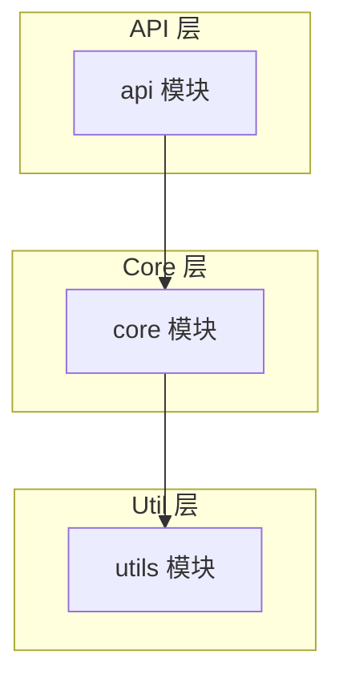

**模式 B：依赖关系图**

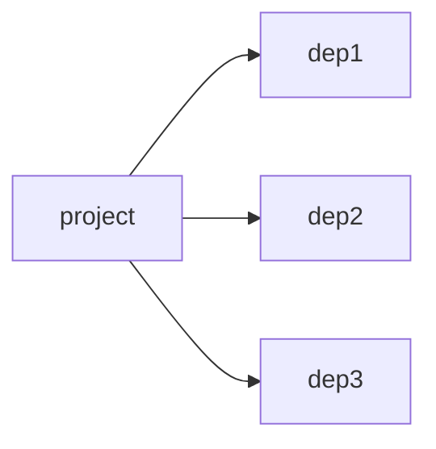

**模式 C：分组架构图**

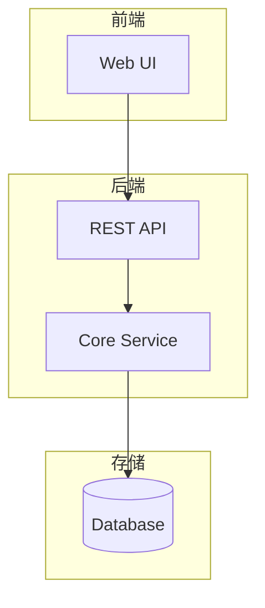

### 2. `classDiagram`：类与接口

**适用场景**：
- 描述类的属性与方法
- 描述类之间的继承、依赖、关联关系

**模式 A：单类展示**

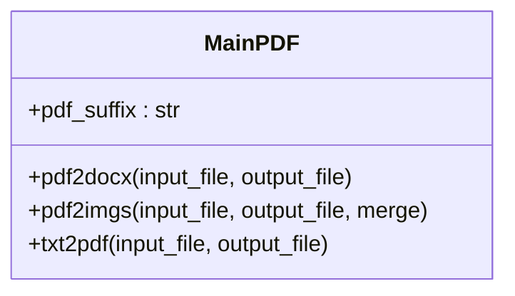

**模式 B：多类关系**

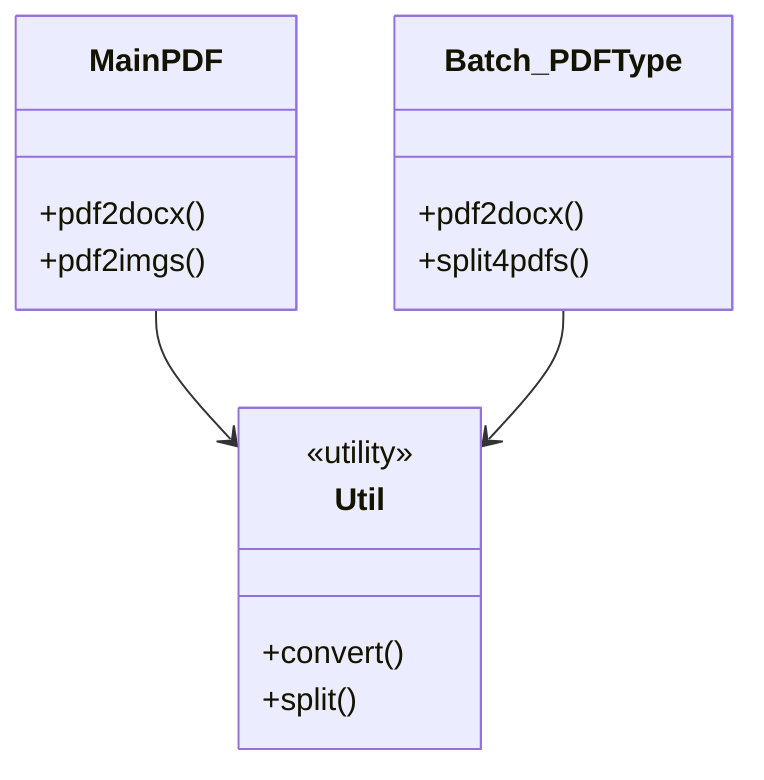

**关系符号**：
- `-->` 依赖
- `--*` 组合
- `--o` 聚合
- `--|> ` 继承 / 实现
- `..>` 弱依赖
- `--` 关联

### 3. `sequenceDiagram`：时序流程

**适用场景**：
- 描述用户 → API → 服务 → DB 的调用时序
- 描述跨模块协作流程

**模式 A：基础时序**

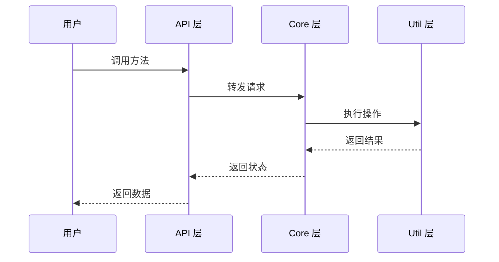

**模式 B：带分支（alt/else）**

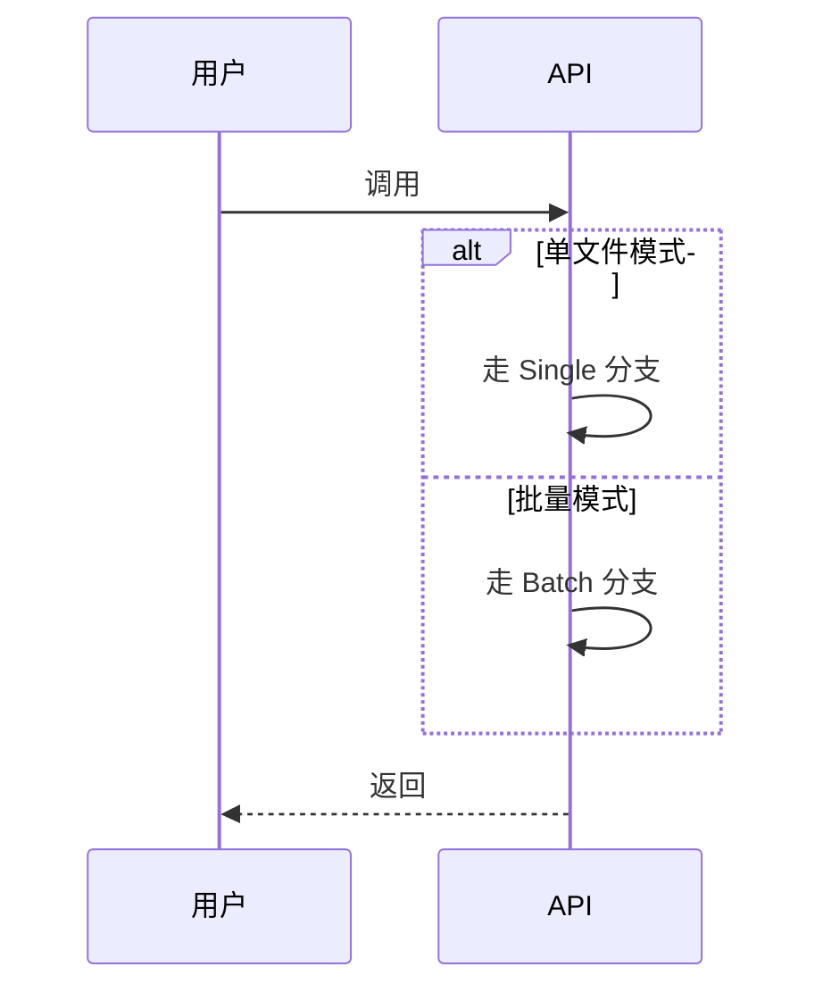

**模式 C：带循环（loop）**

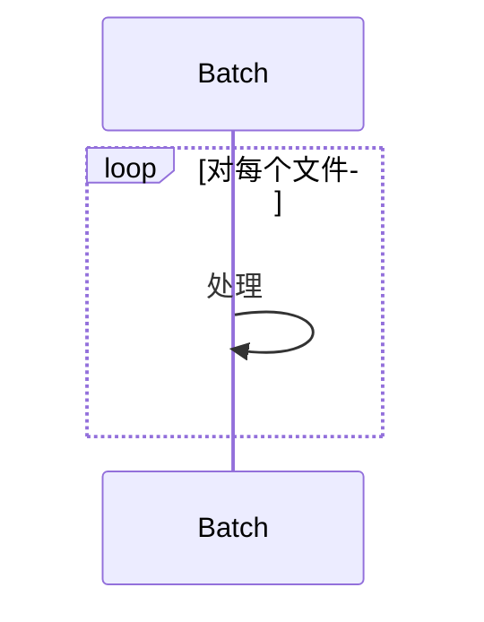

**注意**：mermaid `sequenceDiagram` 中 `participant` 后的别名使用 `as`。

### 4. `flowchart TD`：流程判断

**适用场景**：
- 描述参数校验流程
- 描述异常分支处理
- 描述工作流

**模式 A：判断流程**

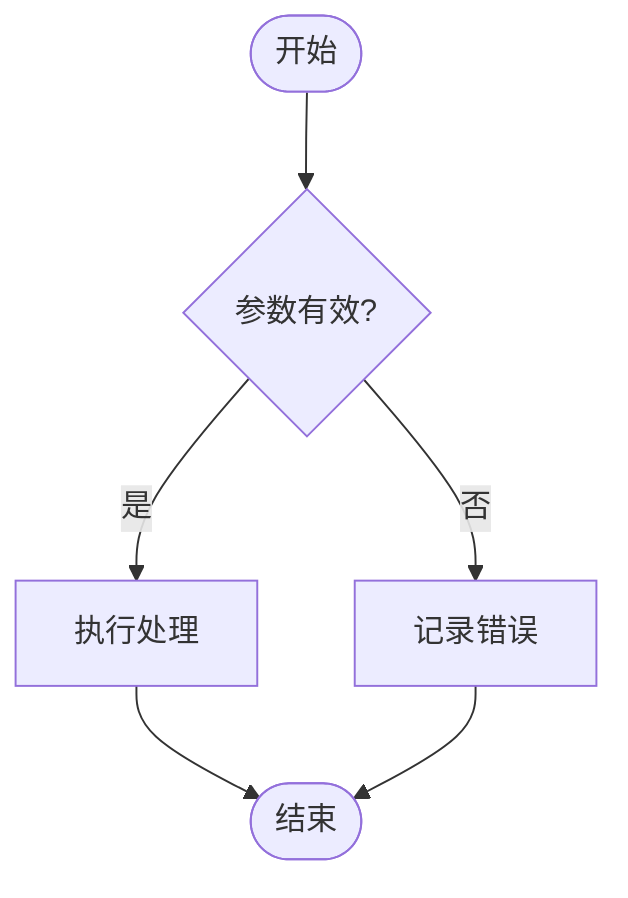

**模式 B：节点命名**

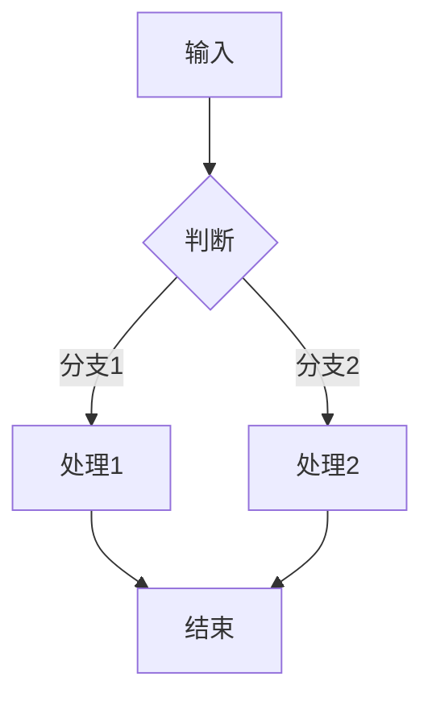

**节点形状**：
- `["text"]` 矩形（默认）
- `("text")` 圆角矩形
- `{"text"}` 菱形（判断）
- `(["text"])` 胶囊形
- `[("text")]` 圆柱形（数据库）
- `[/"text"/]` 平行四边形
- `[\"text"\]` 反平行四边形
- `{{"text"}}` 六边形

### 5. `stateDiagram-v2`：状态机

**适用场景**：
- 描述异常状态流转
- 描述业务对象生命周期

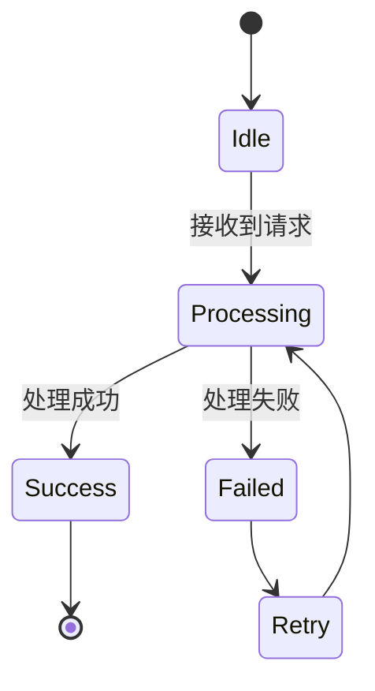

## mermaid 标签中的特殊字符

### 换行

使用 `<br/>`：

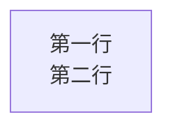

### 括号

在 `["..."]` 内部，括号是安全的：

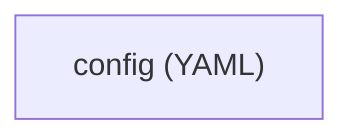

### 引号

在 `["..."]` 内部，引号是安全的：

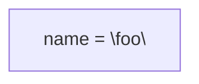

### 特殊符号

避免在标签中使用 mermaid 关键字（如 `end`、`subgraph`、`graph`），如必须使用，加引号或换词。

## popdf repowiki 中的实际案例

### 案例 1：项目分层架构（项目概述.md）

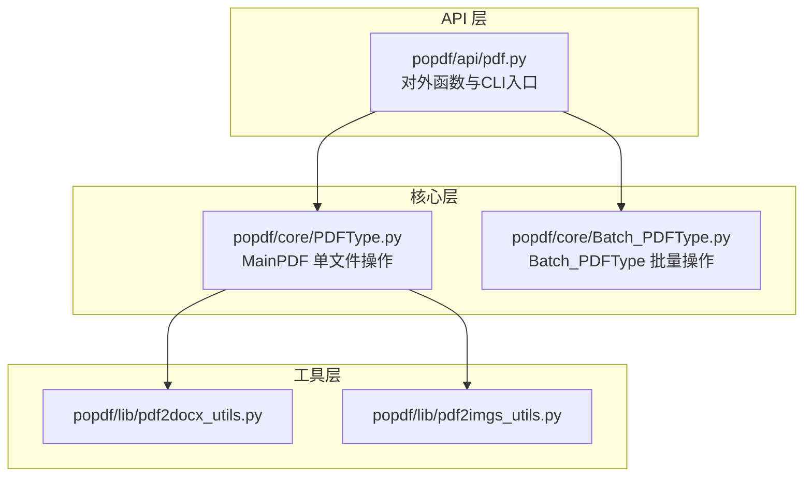

### 案例 2：CLI 时序（项目概述.md）

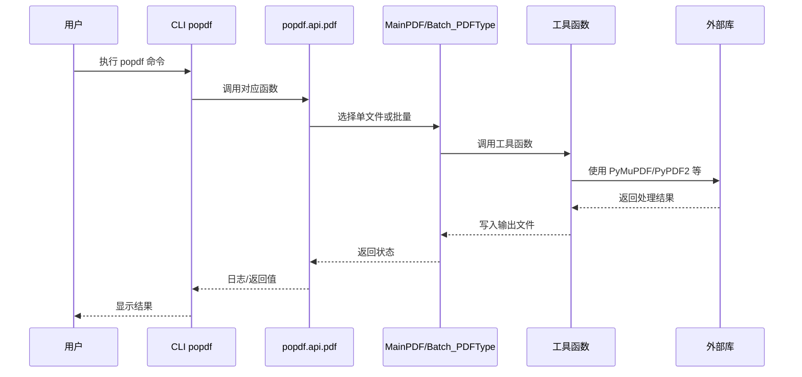

### 案例 3：核心类继承（核心功能详解.md）

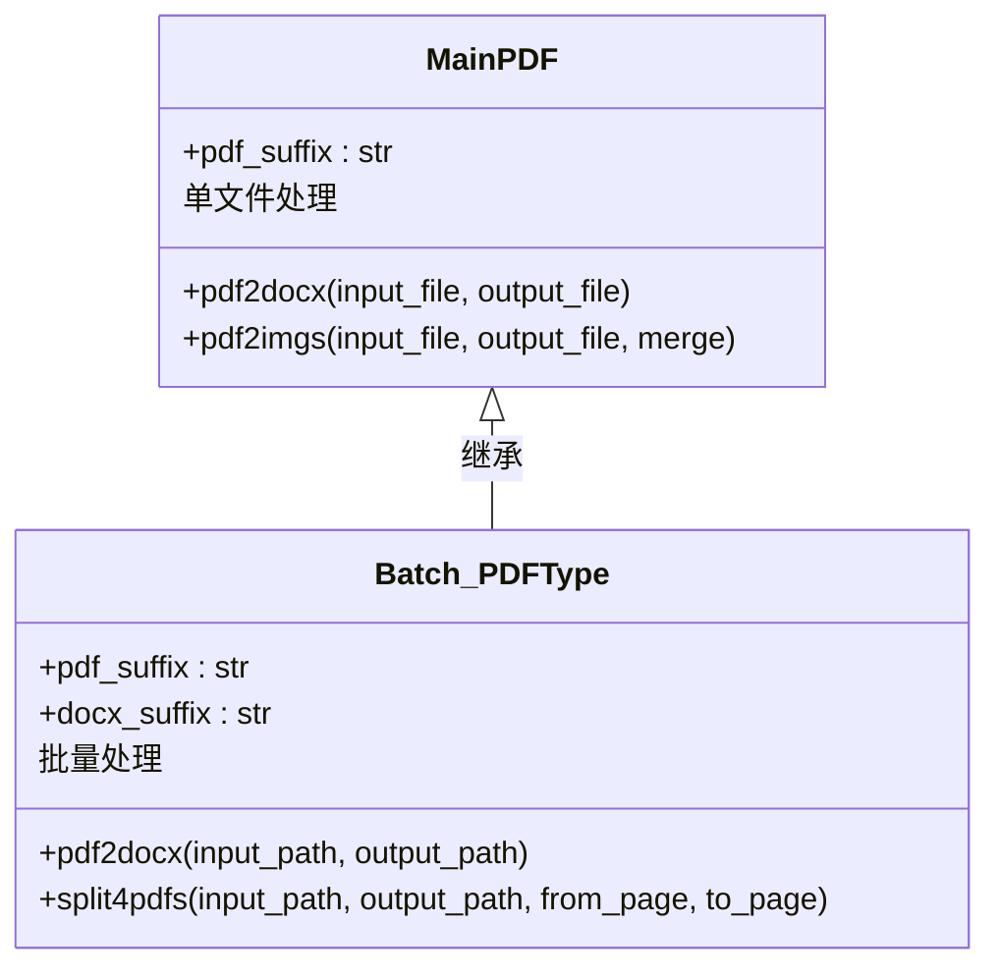

### 案例 4：异常处理流程（API参考.md）

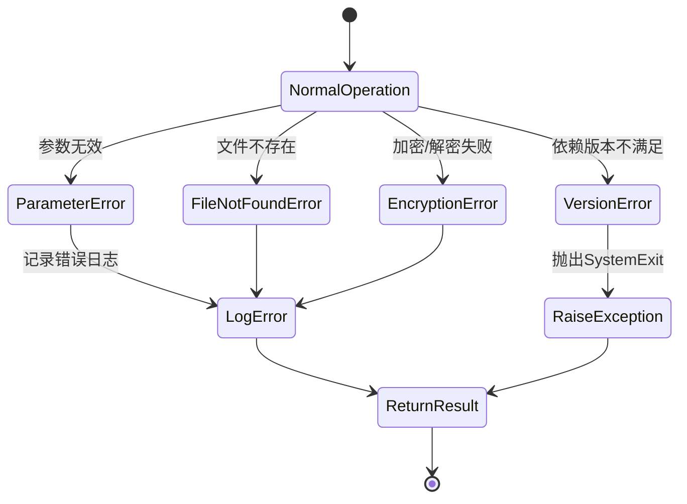

### 案例 5：工具函数流程（核心功能详解.md）

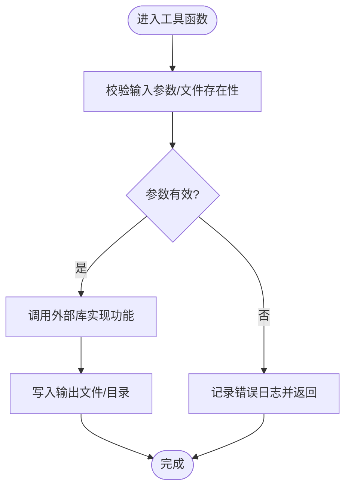

### 案例 6：参数路由流程（PDF转Word.md）

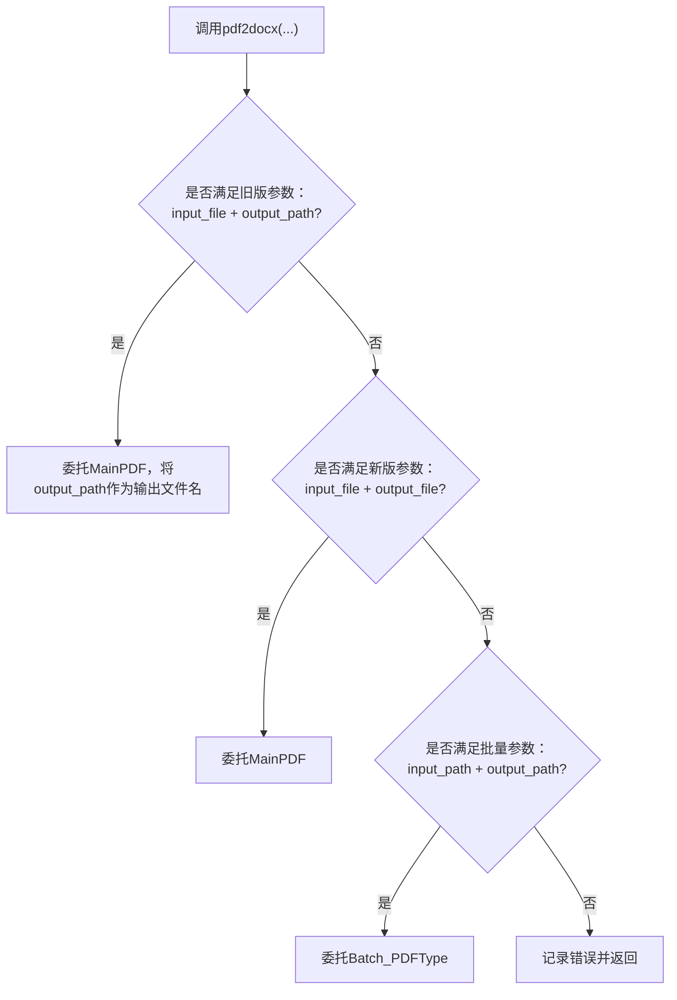

## 选型决策

| 想要表达的内容 | 推荐图表 |
|----------------|----------|
| 目录结构、模块分层 | `graph TB` |
| 数据流向、调用顺序 | `graph LR` 或 `sequenceDiagram` |
| 类与方法签名 | `classDiagram` |
| 跨模块协作时序 | `sequenceDiagram` |
| 业务流程 / 条件分支 | `flowchart TD` |
| 状态机 / 生命周期 | `stateDiagram-v2` |
| 简单的依赖清单 | `graph LR` |
| 异常处理流程 | `flowchart TD` 或 `stateDiagram-v2` |

每篇文档至少包含 2 个 mermaid 图（项目概述 5+ 个，核心功能详解 4+ 个，API 参考 3+ 个）。