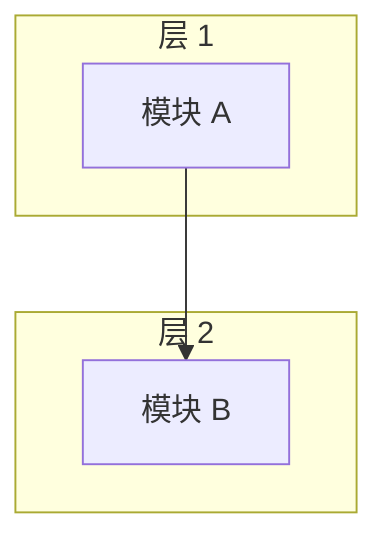
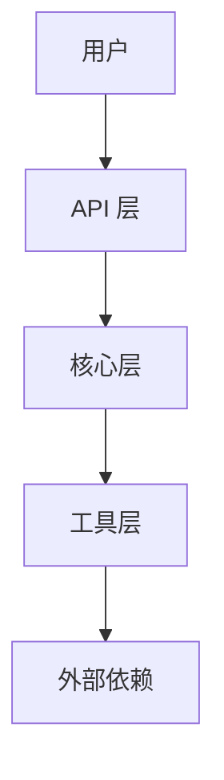
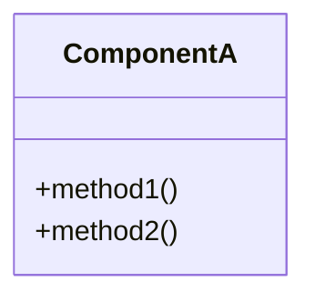
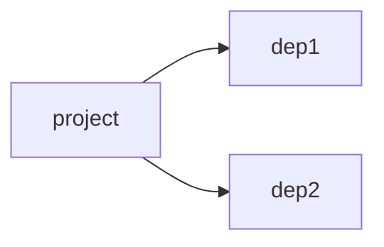

# <项目名称>

<cite>
**本文引用的文件**
- [README.md](file://README.md)
- <其他核心文件>
</cite>

## 目录
1. [简介](#简介)
2. [项目结构](#项目结构)
3. [核心组件](#核心组件)
4. [架构总览](#架构总览)
5. [详细组件分析](#详细组件分析)
6. [依赖关系分析](#依赖关系分析)
7. [性能与可用性考量](#性能与可用性考量)
8. [故障排查指南](#故障排查指南)
9. [结论](#结论)
10. [附录](#附录)

## 简介
<一段话说明项目定位、目标用户、核心价值>

## 项目结构
<描述项目分层/目录结构>

**图表来源**
- [README.md](file://README.md#L1-L50)

## 核心组件
- <组件 1>：一句话职责
- <组件 2>：一句话职责

## 架构总览
<整体架构描述>

**图表来源**
- [<source>](file://<source>#L1-L100)

## 详细组件分析

### 组件 1：<名称>
<职责说明 + 关键 API>

**图表来源**
- [<source>](file://<source>#L1-L100)

### 组件 2：<名称>
<职责说明>

## 依赖关系分析
<依赖清单 + 依赖图>

**图表来源**
- [<deps>](file://<deps>#L1-L30)

## 性能与可用性考量
- <性能要点 1>
- <性能要点 2>

## 故障排查指南
- <问题 1>：排查步骤
- <问题 2>：排查步骤

## 结论
<总结项目价值>

## 附录
- <参考链接>

**章节来源**
- [README.md](file://README.md)
- [<其他>](file://<other>)